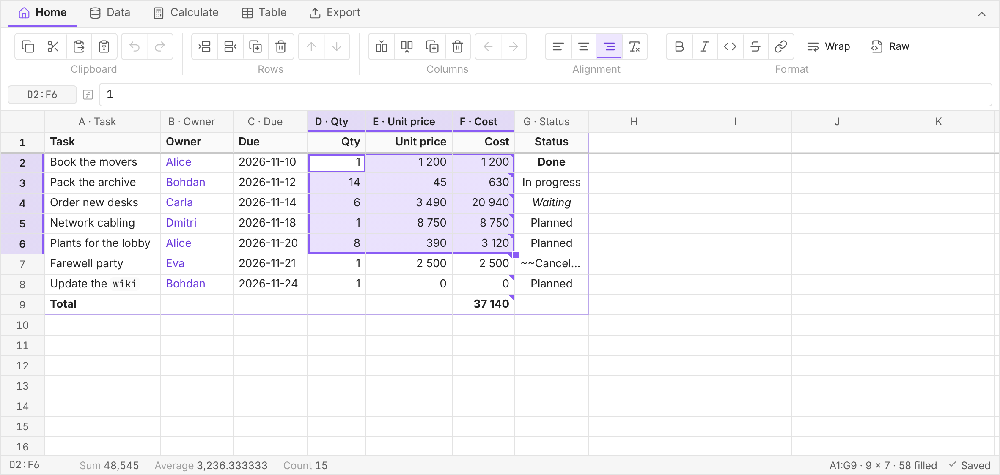
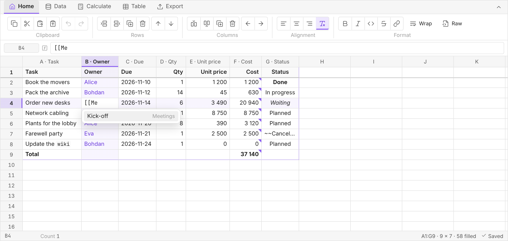
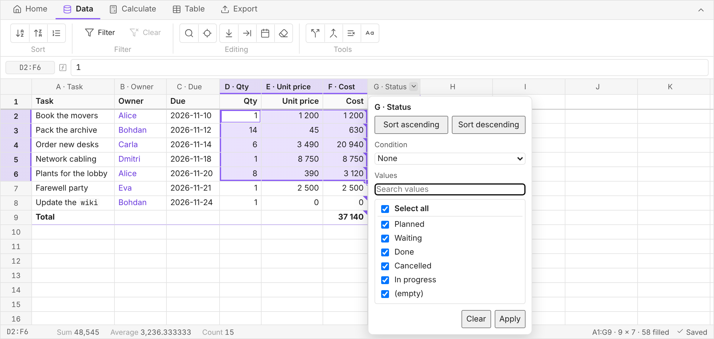
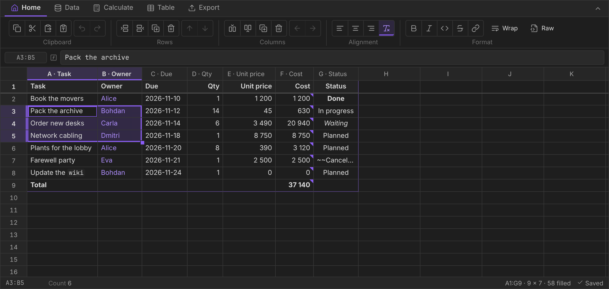
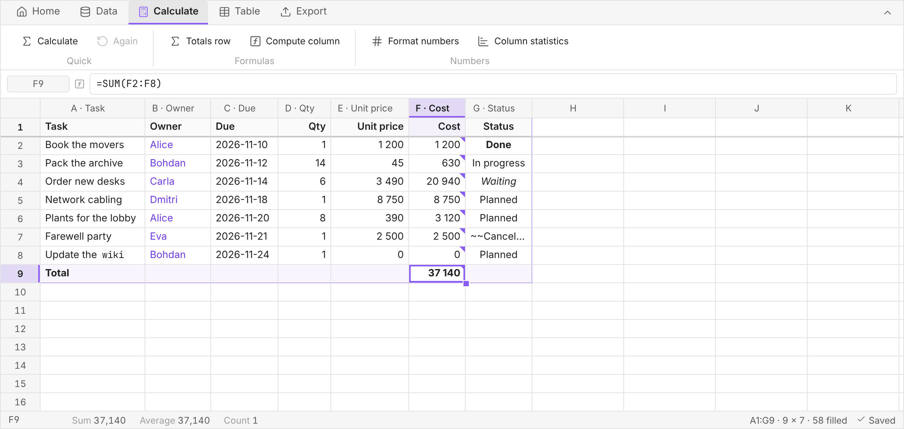
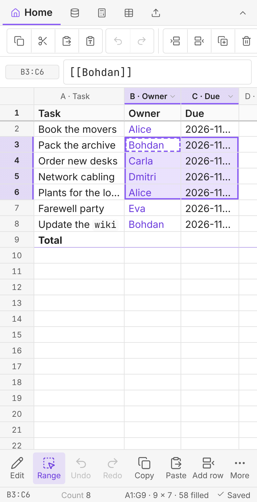

# Markdown Spreadsheets

Edit the Markdown tables in your Obsidian notes in a spreadsheet grid — and get back a table that is
still plain, valid Markdown.



The note stays the source of truth. Nothing goes into it that GitHub-Flavored Markdown cannot
express: no HTML, no merged cells, no colours. Close the plugin, open the note anywhere else, and the
table reads exactly as it did in the grid.

**Contents** — [Getting started](#getting-started) · [What it does](#what-it-does) ·
[Formulas](#formulas) · [Phones and tablets](#phones-and-tablets) · [Keys](#keys) ·
[Settings](#settings-worth-changing) ·
[Limits](#what-it-deliberately-does-not-do) · [Things worth knowing](#things-worth-knowing) ·
[Development](#development)

## Getting started

1. Hover over a table in Live Preview and click the button in its top-right corner (on a phone it
   is always shown) — or put the cursor in a table and run **Open table as a spreadsheet** from the
   command palette, the right-click menu or the sidebar icon.
2. Edit. Type to replace a cell, F2 or a double-click to edit it, Enter to move on.
3. That's it: in automatic save mode the note is updated a moment after you stop typing.

No table yet? **Insert a new table and open it as a spreadsheet** creates one at the cursor, and
**Import a spreadsheet file as a new table** turns a CSV or Excel file into one.

## What it does

### Edit like a spreadsheet

- An infinite grid with column letters and row numbers, frozen header row, resizable columns and
  rows, text wrapping, zoom (Ctrl+wheel) and a formula bar.
- **Excel's keys**: arrows, Shift to extend, Ctrl+arrows to jump, Ctrl+Enter to fill a selection,
  Ctrl+D to fill down, the fill handle for series (numbers, dates, weekdays, `Item 1 → Item 2`).
- **Suggestions while typing**: notes after `[[`, tags after `#`, and the values already used in the
  same column — Alt+↓ lists them all.
- **Pick cells instead of typing them**: while a formula is being typed, a click in the grid writes
  that cell's reference at the caret, and dragging writes a range — as in Excel. The editor keeps
  focus, so the formula carries on where it left off.
- **Rows and columns**: insert, duplicate, delete, move with the buttons or by dragging the row number
  or column letter, hide columns in the grid only.
- **A note with several tables gets sheet tabs** under the grid, labelled by each table's own first
  headers. Clicking one switches the grid to that table; nothing about the note changes, and a
  single-table note shows no strip at all.
- **Cells show what the note shows** — links, emphasis, code and images are rendered; editing always
  shows the Markdown. Ctrl+click follows a link, Ctrl+hover previews it.
- A long cell opens in an editor that grows over its neighbours, so it can be read whole.



### Work with the data

- **Sort and filter from the column header**: the arrow next to a column letter sorts, filters by
  condition (contains, equals, greater than…) or by ticking values. Clicking the letter itself still
  selects the whole column. Filters only hide rows in the grid — the note keeps all of them.
- Sort by several columns, find and replace (with Find next, regex, whole-cell), go to a cell.
- **Tools**: split a column at a separator, merge columns, remove duplicate rows, change case, trim
  spaces, replace `&nbsp;`.
- **Merge a file into the table by a key** — a price list, a stock export or a time sheet comes back
  with the same rows and some new ones: match by the code column, update what the file carries, add
  what is new, and optionally drop what it no longer has. Columns are matched by header name, so a
  reordered export still works, and the dialog says how many rows will be updated, added or removed
  before anything is written.
- **Paste** from Excel, LibreOffice or Google Sheets, a Markdown table copied from a note, a single
  value onto a whole range, transposed, or as plain text. Paste or drop an image and it is saved as
  an attachment and linked; drop a note from the file explorer and it becomes a link.



### Calculate

- The status bar shows the sum, average and count of the selection — click a figure to copy it.
- **Formulas** that stay readable without the plugin (see [below](#formulas)), a **totals row** in
  one click, **compute a column** from an expression such as `[Qty] * [Unit price]`.
- **Column statistics**, **format numbers** as currency, percent or fixed decimals, and one-off
  results (`Calculate`) inserted as plain values.

### Export, import, safety

- Export to CSV, Excel (with real formulas) or JSON — the whole table or just the selection. Copy as
  Markdown, as a formatted table for Word or email, as JSON or as text. Import CSV, TSV or Excel.
- **The stored value is kept current.** A formula cell holds its last value as text, so a note edited
  outside the grid — on your phone, by another plugin, in the source view — would keep a stale
  number. The plugin recalculates such a note in the background, and once over recently edited notes
  when it starts. Only a value that actually changed is written, and a note you have open is left
  alone.
- **Never overwrites silently.** If the table changed in the note while the grid was open, you get
  the choice. The last versions are kept: the table as it was when opened, each save, and — in
  manual save mode — changes you closed without saving. Restoring highlights what changed.
- **Finds the same table again** after you edit the note above it, without marking up your note;
  if two tables are genuinely indistinguishable it asks instead of guessing.
- Optional **compact** table layout (`| a | b |`), so changing one cell changes one line in Git.



## Formulas

Markdown has no formulas, so this plugin keeps them where Obsidian keeps comments: inside the cell,
after the value.

```markdown
| Item    | Cost                          |
| ------- | ----------------------------: |
| Movers  | 1 200                         |
| Desks   | 20 940                        |
| **Total** | **22 140** %%=SUM(B2:B3)%%  |
```

In Obsidian you see `22 140`. In any other Markdown viewer you see `22 140` followed by the formula
as text — the number is always there, and always right as of the last time the grid had the table
open. Type `=SUM(B2:B3)` into a cell (or the formula bar) to create one. The grid recalculates on
every change and when it opens a table, and moves references when rows and columns are inserted or
deleted.

References are spreadsheet style — `B2`, `B2:B9` — where row 1 is the Markdown header. Supported:

- arithmetic `+ - * / ^`, parentheses, and `&` to join text;
- comparisons `= <> < <= > >=` on numbers, text (without case) and `TRUE`/`FALSE`;
- `IF`, `IFERROR`, `AND`, `OR`, `NOT`;
- `SUM`, `AVERAGE`, `MIN`, `MAX`, `COUNT`, `COUNTA`, `MEDIAN`, `PRODUCT`, `ROUND`, `ABS`;
- `SUMIF`, `SUMIFS`, `COUNTIF`, `COUNTIFS`, `AVERAGEIF`, `AVERAGEIFS`, whose criteria take a
  comparison (`">100"`), text, or wildcards (`"*desk*"`, `"?airs"`).

Start typing a function name and the editor lists the ones that match, with their arguments and a
one-line description; Enter writes the name and its opening parenthesis and leaves the caret inside.

A formula can produce text, so `=IF(C2>2, "many", "few")` or `="Total: " & SUM(C2:C9)` is fine;
one line, as the table requires. Errors show as `#REF!`, `#DIV/0!`, `#CYCLE!`, `#VALUE!`,
`#NUM!` or `#NAME?`, and the grid says why under the cell. A cell starting with `==` stays an
Obsidian highlight, and `'=` writes a literal `=`.



## Phones and tablets



In the Obsidian mobile app the grid switches to a **touch layout**:

| Gesture | Action |
| --- | --- |
| Tap | Select a cell, a column letter or a row number |
| Tap the selected cell again | Edit it — the keyboard's return key commits |
| Long press | The context menu: edit, cut, copy, paste, insert, delete — and *Open link* on a link |
| Swipe | Scroll |
| Two fingers | Zoom |
| **Range**, then tap | Extend the selection to the tapped cell, as Shift+click does |
| Arrow in the selected column's letter | Sort and filter |

The action bar under the grid holds what a mouse and keyboard did without a toolbar: edit, range
mode, undo and redo, copy and paste, a new row, and the context menu of the selection. The toolbar
above scrolls sideways and its controls are sized for a finger. Dragging the fill handle, resizing
columns by their border and dragging rows to move them stay desktop gestures; *Fill down*, *Width*
and *Move* on the toolbar do the same.

`Touch layout` in the settings turns it on everywhere (a touchscreen laptop) or off on a tablet with
a keyboard and trackpad.

<br clear="right">

## Keys

| Key | Action |
| --- | --- |
| Arrows · Shift+arrows | Move · extend the selection |
| Ctrl/Cmd+arrows | Jump to the edge of the data |
| Home / End · Ctrl+Home / End | Row start / end · first / last used cell |
| Tab / Shift+Tab · Enter / Shift+Enter | Next / previous cell · down / up |
| Just type | Replace the cell — the arrows then commit and move on, as in Excel |
| F2 or double-click | Edit the cell — the arrows move the caret (F2 again switches) |
| Ctrl+Enter | Write what you typed into every selected cell |
| Alt+↓ | Pick a value already used in the column |
| Ctrl+; · Ctrl+Shift+; | Insert today's date · the time |
| Click or drag a cell while typing a formula | Write its reference, or a range, at the caret |
| Ctrl+K | Turn the selection into a `[[link]]` |
| Ctrl+B / I | Bold, italic — `**x**`, `__x__`, `*x*` and `_x_` are all recognised |
| Ctrl+D | Fill down (a single row copies the row above) |
| Ctrl+G | Go to a cell or column |
| Ctrl+C / X / V | Copy, cut, paste |
| Ctrl+Z / Y | Undo, redo — the grid keeps its own history |
| Ctrl+S | Write back to the note |
| Ctrl+= / - / 0 | Zoom in, out, reset |
| Delete · Esc | Clear the selection · cancel an edit |

Every toolbar action is also a command, so you can give any of them a hotkey of your own in
Obsidian's settings.

## Settings worth changing

| Setting | Default | Why change it |
| --- | --- | --- |
| Save mode | Automatic | Manual if your vault is under Git or Sync and you'd rather save explicitly — with an optional preview of the change. |
| Table layout in the note | Aligned | Compact keeps Git diffs to the line you changed. |
| Open the spreadsheet in | A new tab | A split puts the grid next to the note. |
| Toolbar | Icons and labels | Icons only for a one-row toolbar. |
| Touch layout | Automatic | Always on a touchscreen laptop; never on a tablet with a trackpad. |
| Suggestions while typing | On | Off if you never want the pop-up — including the function list. |
| Recalculate when a note changes | On | Off if your vault is Synced and you would rather the numbers change only while the grid is open. |
| Status bar figures | Sum, average, count | Add minimum, maximum or filled cells. |
| CSV delimiter, byte order mark | `;`, on | What Excel expects where the comma is the decimal mark. |
| Number locale, decimal separator | System | How `1 234,56` is read and results are written. |
| Show the button in reading view | Off | The Live Preview button is always there; this adds it to reading view. It never appears in a PDF. |

## What it deliberately does not do

Markdown tables cannot express these, so the plugin does not pretend otherwise:

| Spreadsheet feature | Why not |
| --- | --- |
| Row 1 as data | GFM requires a header row. Row 1 is the header, always. |
| Merged cells | No GFM equivalent. |
| Line breaks in a cell | A GFM cell is one line, and `<br>` would be HTML. Wrapping in the grid is visual only. |
| Per-cell alignment | GFM aligns whole columns. The alignment buttons apply to the column. |
| Cell colours and fonts | No GFM equivalent — and showing them only in the grid would make it disagree with the note. |
| Live formulas everywhere | Formulas recalculate inside the grid; elsewhere the cell holds the last value. |

Column widths, row heights, wrapping, freezing, zoom and hidden columns are cosmetic and live in the
plugin's own data, not in your note.

## Things worth knowing

- **The touch layout is new.** It was built and tested in a browser's touch emulation, not yet on
  every phone; if a gesture misbehaves on yours, an issue with the device and app version helps.
- **Aimed at tables up to roughly 500 rows.** There is no virtualization; the grid stops growing at
  2000 rows and 128 columns.
- **Undo in the note is coarse.** After a write, Ctrl+Z in the note undoes the whole write as one step.
- **A sparse table gets a warning.** A value in `Z400` forces every cell above and left of it to be
  written; you are told how many empty cells that adds and offered `Shrink to actual data`.
- **A dotted date stays a date.** `07.07.2026` is not a number, so it exports to Excel as text.
- **`&nbsp;` comes from the note**, usually from a table pasted from the web or Word. `Data ▸ Tools ▸
  Change text` replaces it with spaces.
- **Tables inside callouts and block quotes** cannot be opened yet.

## No network, no telemetry

The plugin makes no network requests, loads no remote code, collects nothing and has no runtime
dependencies.

## Development

```bash
npm install
npm run dev     # watch build
npm run check   # styles + typecheck + lint + tests + production build — what CI runs
npm test
```

The Obsidian ESLint plugin is blocking at zero errors and zero warnings. `styles.css` is generated
from `src/styles.src.css` by `scripts/gen-styles.mjs` and committed; CI fails if it is stale.

Releasing is `node scripts/bump-version.mjs <semver>`, then pushing a tag named exactly like the
version — `0.2.0`, never `v0.2.0`. A workflow does the rest; see `RELEASING.md`.

- `docs/design` — the specification this implements.
- `docs/DECISIONS.md` — where the implementation departs from it, and why.
- `docs/HANDOFF.md` — current state, what has never run inside Obsidian, known gaps.
- `CLAUDE.md` — the invariants and Obsidian conventions this code is built on.

The screenshots are rendered from the plugin's real view code in a headless browser, with mock data.

## Third-party attribution

None at runtime. The build-time tools (esbuild, TypeScript, ESLint, `eslint-plugin-obsidianmd`,
Vitest) are MIT-licensed and not bundled into `main.js`. The design credits
`@tgrosinger/md-advanced-tables` and `ganesshkumar/obsidian-table-editor` (both MIT) as prior art;
see `docs/DECISIONS.md` for why neither became a dependency.

## Licence

MIT — see `LICENSE`.
